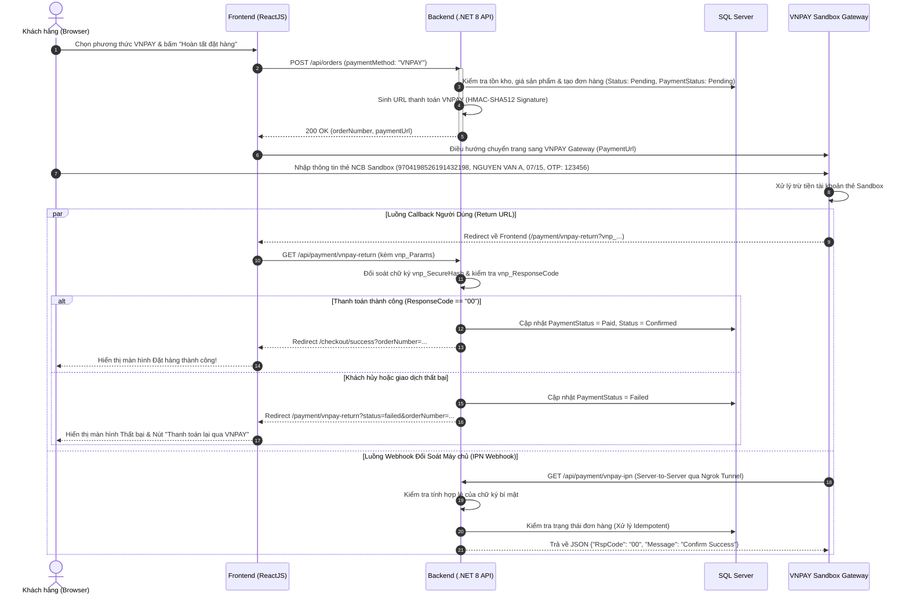

# Tích Hợp Cổng Thanh Toán Trực Tuyến VNPay Sandbox (Payment Integration)

> Tài liệu mô tả chi tiết kiến trúc, thiết kế kỹ thuật, luồng xử lý giao dịch, cơ chế bảo mật và quy chuẩn kiểm thử tự động của tính năng thanh toán trực tuyến qua cổng VNPay Sandbox trên hệ thống thương mại điện tử Urban Stitch.

---

## 1. Giới thiệu Tổng quan

Tính năng thanh toán trực tuyến cho phép khách hàng (cả Khách vãng lai và Thành viên đăng nhập) thanh toán đơn hàng qua cổng thanh toán điện tử **VNPAY Sandbox** thông qua thẻ ATM nội địa (ngân hàng NCB Sandbox), Internet Banking, hoặc quét mã VNPAY-QR.

Hệ thống được thiết kế theo nguyên lý **Clean Architecture** chuẩn mực, hỗ trợ xử lý phản hồi kép (Return URL đồng bộ phía Client và IPN Webhook bất đồng bộ phía Server), chống giả mạo chữ ký số (Checksum HMAC-SHA512), xử lý giao dịch lặp (Idempotency) và hỗ trợ tính năng "Thanh toán lại" khi khách hàng gặp sự cố gián đoạn.

---

## 2. Kiến trúc Phân tầng & Tuân thủ Clean Architecture

Nhằm tuân thủ nghiêm ngặt nguyên lý đảo ngược phụ thuộc (Dependency Inversion Principle - DIP), toàn bộ nghiệp vụ thanh toán được phân tách rành mạch giữa 2 tầng:

```
┌────────────────────────────────────────────────────────────────────────┐
│                        APPLICATION LAYER                               │
│  📁 Common/Services/Payments/                                          │
│     ├── IVnPayService.cs      (Hợp đồng nghiệp vụ thanh toán)          │
│     ├── VnPayDtos.cs          (Request/Response DTOs: PaymentUrl, IPN) │
│     └── VnPaySettings.cs      (Options Pattern: TmnCode, HashSecret...)│
│  * Hoàn toàn không phụ thuộc vào SDK bên thứ ba hay Web Framework.    │
└──────────────────────────────────▲─────────────────────────────────────┘
                                   │ Implements (Dependency Inversion)
┌──────────────────────────────────┴─────────────────────────────────────┐
│                      INFRASTRUCTURE LAYER                              │
│  📁 Payments/                                                          │
│     └── VnPayService.cs       (Triển khai thuật toán mã hóa HMAC-SHA512│
│                                URL Encoding, đối soát chữ ký, IPN Callback)
│  * Sử dụng các thư viện bảo mật hệ thống (System.Security.Cryptography)│
└────────────────────────────────────────────────────────────────────────┘
```

### 2.1. Layer `Application` (`apple-store-app/src/App/Application`)
- **[IVnPayService.cs](file:///c:/Users/Admin/Documents/ecommerce-apple-store/apple-store-app/src/App/Application/Common/Services/Payments/IVnPayService.cs):**
  - `CreatePaymentUrl(VnPayCreatePaymentRequest request)`: Tạo URL thanh toán VNPay có gắn chữ ký số.
  - `ProcessReturn(IDictionary<string, string> queryParameters)`: Giải mã và kiểm tra tính hợp lệ của Return URL.
  - `ProcessIpn(IDictionary<string, string> queryParameters)`: Tiếp nhận và xác thực giao dịch từ Webhook IPN.
- **[VnPayDtos.cs](file:///c:/Users/Admin/Documents/ecommerce-apple-store/apple-store-app/src/App/Application/Common/Services/Payments/VnPayDtos.cs):** Định nghĩa các DTO thuần túy (`VnPayCreatePaymentRequest`, `VnPayCallbackResult`, `VnPayIpnResponse`).
- **[VnPaySettings.cs](file:///c:/Users/Admin/Documents/ecommerce-apple-store/apple-store-app/src/App/Application/Common/Services/Payments/VnPaySettings.cs):** Cấu hình cổng thanh toán nạp qua `IOptions<VnPaySettings>`.

### 2.2. Layer `Infrastructure` (`apple-store-app/src/App/Infrastructure`)
- **[VnPayService.cs](file:///c:/Users/Admin/Documents/ecommerce-apple-store/apple-store-app/src/App/Infrastructure/Payments/VnPayService.cs):**
  - Triển khai thuật toán băm mật mã HMAC-SHA512.
  - Sắp xếp từ điển tham số theo bảng chữ cái ASCII (`SortedList` với custom comparer).
  - Chuẩn hóa múi giờ Việt Nam (`UTC+7`) cho `vnp_CreateDate` và `vnp_ExpireDate` khi chạy trong Linux Docker container để chống lỗi hết hạn giao dịch (Error code 15).
  - Đăng ký DI Scoped tại [Infrastructure/DependencyInjection.cs](file:///c:/Users/Admin/Documents/ecommerce-apple-store/apple-store-app/src/App/Infrastructure/DependencyInjection.cs).

---

## 3. Sơ đồ Luồng Giao dịch (Sequence Diagram)



---

## 4. Các Biện pháp An ninh & Bảo mật

1. **Bảo mật Chữ ký số (HMAC-SHA512 Checksum):**
   - Mọi URL gửi sang VNPAY đều chứa `vnp_SecureHash` được tạo từ toàn bộ tham số truy vấn (đã sort) kết hợp với chuỗi khóa bí mật `HashSecret`.
   - Phía Backend kiểm tra lại chữ ký trên cả 2 kênh (Return URL và IPN). Mọi yêu cầu có chữ ký không khớp lập tức bị từ chối với mã lỗi `97: Invalid Signature`.
2. **Ngăn chặn Xử lý Lặp (Idempotency Control):**
   - Cả Return URL và IPN Webhook đều có thể cập nhật trạng thái đơn hàng.
   - Khi IPN nhận được yêu cầu của một đơn đã ở trạng thái `Paid` hoặc đã kết thúc, hệ thống sẽ trả về mã `02: Order already confirmed`, ngăn chặn việc ghi đè trạng thái nhiều lần hoặc lặp lại thao tác xử lý nghiệp vụ.
3. **Múi giờ Giao dịch Chuẩn hóa (Vietnam Time UTC+7):**
   - VNPAY yêu cầu `vnp_CreateDate` và `vnp_ExpireDate` phải theo múi giờ Việt Nam.
   - Khi chạy trong container Docker chạy Linux (mặc định múi giờ UTC+0), hệ thống tự động quy đổi `DateTime.UtcNow.AddHours(7)` để đảm bảo giao dịch không bị VNPAY từ chối với lỗi mã `15: Giao dịch đã quá thời gian chờ thanh toán`.
4. **Không hiển thị đơn chưa thanh toán bừa bãi:**
   - Đối với khách vãng lai chọn thanh toán VNPAY nhưng tắt trình duyệt/không thanh toán: Đơn hàng ở trạng thái `PaymentStatus = Pending` sẽ không được hiển thị trong danh sách "Đơn hàng gần đây" để tránh gây hiểu nhầm cho khách hàng là đơn đã được duyệt.

---

## 5. Tính năng "Thanh toán lại qua VNPAY" (Repayment Flow)

Khi khách hàng gặp sự cố trong quá trình thanh toán (hủy giao dịch trên cổng VNPAY, mất kết nối mạng, thẻ không đủ số dư):
1. Đơn hàng vẫn được lưu ở trạng thái `PaymentStatus: Failed` hoặc `Pending`.
2. Khách hàng đăng nhập có thể truy cập mục **"Đơn hàng của tôi" (`/orders`)**, các đơn hàng VNPAY chưa hoàn tất sẽ có nút bấm nổi bật: **"Thanh toán lại VNPAY"**.
3. Khi bấm nút, Frontend gọi API `POST /api/payment/repay-vnpay/{orderNumber}`, Backend tự động xác thực quyền sở hữu đơn hàng, sinh URL thanh toán mới với hạn thanh toán mới và chuyển hướng khách hàng tiếp tục thanh toán mà không cần đặt lại đơn từ đầu.

---

## 6. Cấu hình Biến Môi trường (.env & Docker Compose)

Toàn bộ thông số kết nối được đồng bộ tập trung qua file `.env`:

```env
# Cấu hình Cổng thanh toán VNPAY Sandbox
VNPAY_TMN_CODE=MAPPJ5MO
VNPAY_HASH_SECRET=KTXCJNCFHZCIUHUGXICGDMMFHGJMBKPV
VNPAY_PAYMENT_URL=https://sandbox.vnpayment.vn/paymentv2/vpcpay.html
VNPAY_RETURN_URL=http://localhost:8088/api/payment/vnpay-return
VNPAY_FRONTEND_RETURN_URL=http://localhost:3088/payment/vnpay-return

# Ngrok Authtoken hỗ trợ IPN Webhook
NGROK_AUTHTOKEN=2p7YZ6rTUJg9Kar5ZGjvcviLAB4_55fZpEnVRnn2ZN3T7DNfp
```

Khi chạy qua `docker-compose.yml`, các biến trên được truyền trực tiếp vào container `apple-store-backend` và dịch vụ `apple-store-ngrok` để tunnel webhook công khai mà không cần can thiệp thủ công vào code.

---

## 7. Bộ Kiểm thử Tự động E2E Headless Playwright

Tệp kiểm thử: [test-playwright/e2e/vnpay-payment-flow.spec.ts](file:///c:/Users/Admin/Documents/ecommerce-apple-store/test-playwright/e2e/vnpay-payment-flow.spec.ts) bao gồm 5 kịch bản bao phủ toàn diện:

| STT | Kịch bản kiểm thử | Kết quả | Thời gian chạy |
| :---: | :--- | :---: | :---: |
| 1 | **Luồng hoàn chỉnh:** User đăng nhập đặt hàng qua VNPAY, điền thẻ NCB Sandbox và thanh toán thành công | ✅ PASS | 15.3s |
| 2 | **Case oái oăm:** Khách hủy giao dịch trên VNPAY Sandbox $\rightarrow$ Hiển thị màn hình thất bại & hỗ trợ thanh toán lại | ✅ PASS | 6.1s |
| 3 | **Case oái oăm:** Bấm nút "Thanh toán lại VNPAY" từ trang Đơn hàng của tôi chuyển hướng sang VNPAY thành công | ✅ PASS | 2.4s |
| 4 | **Case oái oăm:** Khách vãng lai chọn VNPAY nhưng không thanh toán $\rightarrow$ Đơn không xuất hiện bừa bãi trong đơn gần đây | ✅ PASS | 39ms |
| 5 | **Case oái oăm:** Webhook IPN Backend đối soát chữ ký giả mạo (`RspCode: 97`) và cập nhật đơn hợp lệ (`RspCode: 00`, idempotent `RspCode: 02`) | ✅ PASS | 64ms |

**Tổng kết:** 5/5 kịch bản kiểm thử vượt qua 100% trên môi trường Docker Compose.
